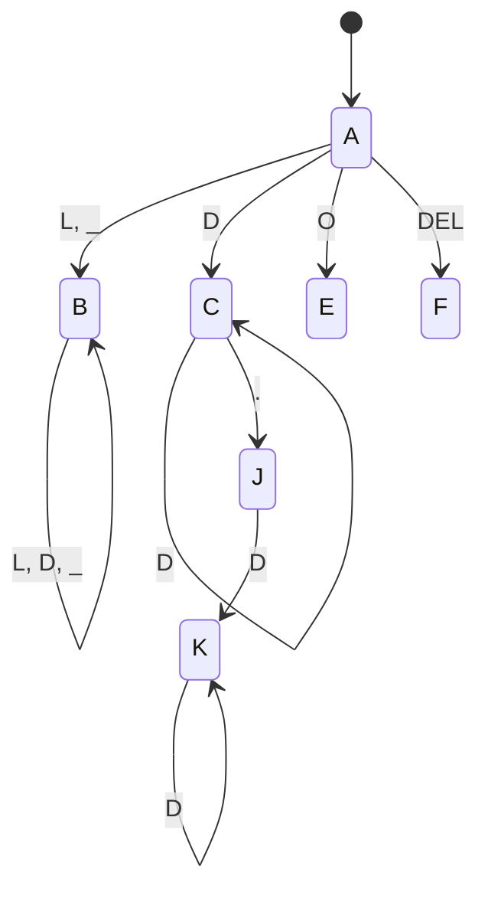

# Analizador Léxico — Documentación

## 1. Alfabeto

| Símbolo | Conjunto |
|---|---|
| L | a–z, A–Z |
| D | 0–9 |
| _ | guion bajo |
| . | punto |
| O | + - * / = |
| DEL | ( ) ; { } |

Todo carácter fuera de este conjunto es un error léxico ("Carácter no reconocido").

## 2. Expresiones regulares (solo documentación; el código NO usa regex)

| Token | Expresión |
|---|---|
| TOKEN_ID | (L \| _)(L \| D \| _)* |
| TOKEN_INT | D+ |
| TOKEN_FLOAT | D+ . D+ |
| TOKEN_OP | + \| - \| * \| / \| = |
| TOKEN_DELIM | ( \| ) \| ; \| { \| } |
| Palabras reservadas | var, print, if, else (palabra exacta; se detectan tras aceptar un identificador) |

## 3. AFD minimizado (7 estados + pozo)

- Estado inicial: **A**
- Estados finales: **B** (TOKEN_ID), **C** (TOKEN_INT), **K** (TOKEN_FLOAT), **E** (TOKEN_OP), **F** (TOKEN_DELIM)
- **J**: estado intermedio tras el punto (obligatorio un dígito después)
- **TR**: estado pozo; toda transición no dibujada va a TR

### Tabla de transiciones (generada desde el código, `afd.py`)

| Estado | L | D | _ | . | O | DEL |
|---|---|---|---|---|---|---|
| →A | B | C | B | TR | E | F |
| *B | B | B | B | TR | TR | TR |
| *C | TR | C | TR | J | TR | TR |
| *E | TR | TR | TR | TR | TR | TR |
| *F | TR | TR | TR | TR | TR | TR |
| J | TR | K | TR | TR | TR | TR |
| *K | TR | K | TR | TR | TR | TR |
| TR | TR | TR | TR | TR | TR | TR |

(→ inicial, * final)

## 4. Funcionamiento del analizador (`analizador_lexer.py`)

1. Recorre el texto carácter por carácter llevando línea y columna.
2. **Ignorables** (manejados por el lexer, no por el AFD): espacios, tabuladores, saltos de línea y comentarios `//` hasta fin de línea.
3. **Máxima coincidencia**: el AFD avanza lo más posible y recuerda el último estado final visitado; el token es ese prefijo.
4. Si el token es un identificador y está en el diccionario de palabras reservadas, se cambia a TOKEN_VAR / TOKEN_PRINT / TOKEN_IF / TOKEN_ELSE.
5. Identificadores y palabras reservadas se registran en la **tabla de símbolos** (primera aparición y ocurrencias).

## 5. Manejo de errores léxicos

| Caso | Error reportado |
|---|---|
| Carácter fuera del alfabeto (`@`, `#`, `ñ`) | Carácter no reconocido |
| `12.3.4`, `7.`, `.5` | Número mal formado (se consume toda la racha de dígitos y puntos) |
| `.` suelto | Punto '.' fuera de un número |

Tras cada error el análisis continúa; todos los errores se reportan con línea y columna.

## 6. Módulos

`tokens.py` · `clasificador.py` · `afd.py` · `tabla_simbolos.py` · `analizador_lexer.py` · `gui.py` · `main.py` · `pruebas/`
